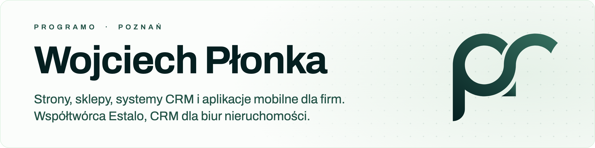

<picture>
  <source media="(prefers-color-scheme: dark)" srcset="assets/banner-dark.png">
  
</picture>

Prowadzę z Bartoszem Kolajem [Programo](https://programo.pl), software house z Poznania. Robimy dla firm strony, sklepy internetowe, systemy CRM i aplikacje mobilne, od makiety po utrzymanie na naszym serwerze. Obok rozwijamy własny produkt, [Estalo](https://estalo.pl).

Większość kodu piszę dziś razem z Claude Code. AI pisze dużą część linijek; ja decyduję, co powstaje, sprawdzam to i odpowiadam za to, co trafia na produkcję. Studiuję informatykę w Collegium Da Vinci.

### Co buduję

**[Programo](https://programo.pl)** to spółka jawna od kwietnia 2026. Strony i sklepy stawiamy na Next.js (treści często w Payload CMS), do tego systemy CRM i aplikacje na iOS i Androida. Wdrażamy w kontenerach Docker przez Coolify na własnym serwerze.

**[Estalo](https://estalo.pl)** to CRM dla biur nieruchomości. Po spotkaniu agent mówi jedno zdanie, a Estalo zakłada klienta, zadania i przypomnienia; oferty trafiają do Otodom przez API. Działa na produkcji od lipca 2026, w przeglądarce i w aplikacjach z [App Store](https://apps.apple.com/pl/app/estalo/id6790190424) i [Google Play](https://play.google.com/store/apps/details?id=pl.estalo.app). Pod spodem Next.js, Supabase na własnym serwerze, Stripe, SwiftUI i Kotlin.

### Projekty publiczne

| Projekt | Co robi | Stack |
| --- | --- | --- |
| [Solvio](https://github.com/Plonkawojciech/Solvio) · [demo](https://solvioaitracking.vercel.app) | Śledzenie wydatków: OCR paragonów, wspólne wydatki w grupie, porównanie cen i raporty | Next.js, PostgreSQL, SwiftUI, Kotlin |
| [Szept](https://github.com/Plonkawojciech/voiceflow-apple) | Dyktowanie do dowolnej aplikacji na Macu na Apple Speech; iPhone może służyć za zdalny mikrofon | Swift, Node.js |
| [Open-Kaap Pro](https://github.com/Plonkawojciech/open-kaap-pro) · [demo](https://open-kaap-pro.vercel.app) | Czat z modelami OpenAI, Anthropic, Google i DeepSeek: jedno pytanie do kilku modeli naraz, koszt w złotówkach przed wyborem | Next.js, Vercel AI SDK |
| [LearnAI](https://github.com/Plonkawojciech/learnai) · [demo](https://learnai-rho.vercel.app) | Prototyp platformy do nauki pracy z AI: lekcje, quizy i symulator promptów, który ocenia odpowiedź przez Claude API | Next.js, Claude API |
| [Przewidywanie upadłości](https://github.com/Plonkawojciech/projekt-ml-bankructwa) · [demo](https://predykcja-bankructwa.vercel.app) | Projekt ze studiów: 43 tys. polskich firm, 64 wskaźniki finansowe, cztery klasyfikatory, wyjaśnienia SHAP i analiza kosztów błędów | Python, scikit-learn, SHAP |
| [Programowanie niskopoziomowe](https://github.com/Plonkawojciech/Programowanie-niskopoziomowe) | Ćwiczenia ze studiów: stos i sterta, układ struktur w pamięci, wyszukiwanie binarne na wskaźnikach, procesy w Windows | C |

### Stack

| | |
| --- | --- |
| Języki | TypeScript, Swift, Kotlin, Python, SQL |
| Web | Next.js, React, Tailwind CSS, Payload CMS |
| Backend i dane | Node.js, PostgreSQL, Supabase, Stripe |
| Mobile | SwiftUI, Android (Kotlin) |
| Infrastruktura | Docker, Coolify, Linux na własnej maszynie wirtualnej |
| AI | Claude API, OpenAI API, Vercel AI SDK; na co dzień Claude Code i Codex |

### Teraz, listopad 2026

- Rozwijam Estalo i rozmawiam z biurami nieruchomości, które chcą przestać prowadzić klientów w arkuszu.
- Robię strony, sklepy i CRM-y dla klientów Programo.
- Po pracy trenuję pod sezon kolarski 2027.

### Kontakt

Kod klientów trzymamy w prywatnych repozytoriach, więc tutaj widać tylko projekty własne i studenckie. Jeśli chcesz coś z nami zbudować, napisz na [wojciech.plonka@programo.pl](mailto:wojciech.plonka@programo.pl) albo zajrzyj na [programo.pl](https://programo.pl).

<b>English</b>

 

I run [Programo](https://programo.pl), a software studio in Poznań, Poland, together with Bartosz Kolaj. We build websites, online stores, CRM systems and mobile apps for businesses, from the first mockup to hosting and maintenance on our own server. On the side we're building our own product, [Estalo](https://estalo.pl).

Most of my code today gets written together with Claude Code. The AI writes a large share of the lines; I decide what gets built, review it and own what goes to production. I'm also studying computer science at Collegium Da Vinci.

**[Programo](https://programo.pl)** has been a registered partnership since April 2026. Websites and stores run on Next.js (content often in Payload CMS), alongside CRM systems and iOS and Android apps. We deploy in Docker containers through Coolify on our own server.

**[Estalo](https://estalo.pl)** is a CRM for real estate agencies. After a meeting the agent says one sentence and Estalo creates the client, tasks and reminders; listings go to Otodom through its API. It's been in production since July 2026, on the web and as apps on the [App Store](https://apps.apple.com/pl/app/estalo/id6790190424) and [Google Play](https://play.google.com/store/apps/details?id=pl.estalo.app). Built with Next.js, self-hosted Supabase, Stripe, SwiftUI and Kotlin.

Public projects, in short: [Solvio](https://github.com/Plonkawojciech/Solvio) tracks expenses from receipt photos, [Szept](https://github.com/Plonkawojciech/voiceflow-apple) is system-wide dictation for macOS, [Open-Kaap Pro](https://github.com/Plonkawojciech/open-kaap-pro) puts several LLM providers side by side, [LearnAI](https://github.com/Plonkawojciech/learnai) is a prototype course platform for working with AI, and the last two are university projects in machine learning and C.

Client code lives in private repositories. To work with us, write to [wojciech.plonka@programo.pl](mailto:wojciech.plonka@programo.pl) or visit [programo.pl](https://programo.pl).

